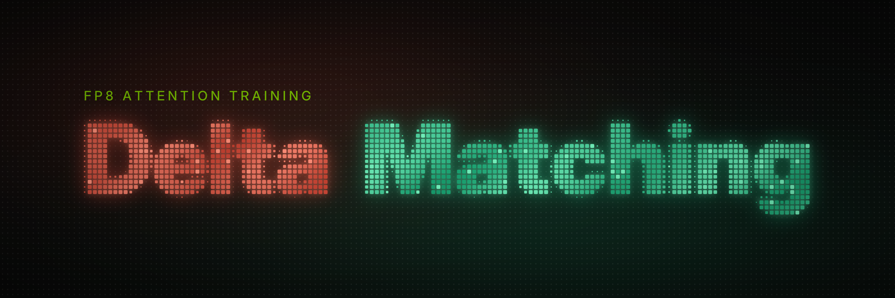
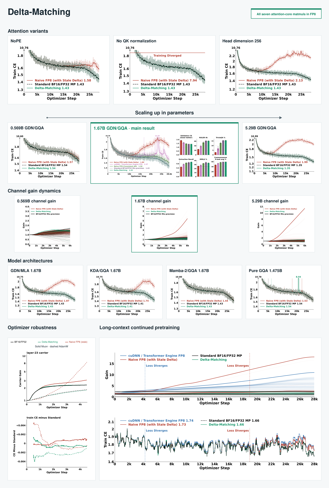

# delta-matching-train



This repository contains the official training and evaluation code of the Delta-Matching: fp8 attention training in which the backward's softmax correction term (the "delta", the row sum of dO times O) is recomputed from the backward's own fp8 P and dP instead of
the forward's bf16 output, so the five backward matmuls and the two forward matmuls of attention all run in fp8 while the
gradient stays consistent with the realized fp8 forward. The kernel itself is the separate **delta-matching** package
(`delta_matching`, a flash-attention-style drop-in for Hopper: `https://github.com/jet-ai-projects/delta-matching`); this
repository is the pretraining engine, the model configs, the data recipe, the experiment launchers and the evaluation
suite that trained and scored the arms of the following paper.

**Delta-Matching: Closing the Final Gap of Native 8-bit Training for LLMs**
Haozhan Tang, Hao Kang, Han Cai, Song Han, Chenyan Xiong<br>
Paper: https://arxiv.org/abs/2609.37852


## What is here

```
data/                    the data recipe: how to rebuild both training corpora and the evaluation data from their public
                         sources (README.md, pretrain_stage1.md, pretrain_stage2.md) and the code that does it
src/pretrain/            the pretraining engine (DDP + FSDP2, DCP checkpoints, exact resume, WSD, fp8 GEMMs via torchao)
  modeling/              GQA / GatedDeltaNet / Mamba2 / KDA / MLA mixers; dm_attention.py (the fp8 attention mixer);
                         attention.py (attn_impl flash | sdpa | dm | te_fp8); mlp_fp8glue.py (the fp8 cast glue)
  configs/               the study's models (Qwen3.5-shaped 3:1 hybrids, Qwen3-shaped pure attention); configs/README.md
  hf/                    the `dmlm` Hugging Face bridge (export, load; no remote code needed with this repository on the path)
src/kernel/dm_port/      the dm mixer's orchestrator around the delta_matching kernel + its fused Triton producers
src/kernel/fp8glue/      Triton ports of the fp8 cast glue (RMSNorm/SwiGLU + cast, cast-transpose twins, delayed scaling)
src/evaluation/          the eval harness: val CE (memmap_ppl), RULER, lm-eval tasks (CS9, extraction, TriviaQA, MMLU), MQAR
src/inference/           the continuous-batching generation engine used by RULER, extraction and TriviaQA
scripts/experiments/     the paper's experiments, one script each (README.md): train and evaluate every arm and seed
scripts/campaign/        env.sh (the environment contract), arms.sh (every arm), train_arm.sh, stage2_arm.sh,
                         eval_arm.sh, eval_arm_64k.sh, and the analysis tools (report_table.py, paired_pair.py, ...)
scripts/hf/              checkpoint -> HF export -> standalone Hub repo (HF_CONVERSION.md)
tests/                   environment, data, kernel, training, resume, launcher and evaluation checks (tests/README.md)
docs/                    SETUP.md (install + run), train_engine.md, eval_engine.md, benchmark.md (the evaluation protocol)
```

## The arms

Every arm of an experiment trains the same model from the same initialization on the same data order; only the
attention numerics differ. `dm_mode` selects the fp8 backward's delta:

| arm (paper name) | launcher name | attention |
|---|---|---|
| Standard BF16/FP32 Mix-precision | `clean_hd128` | bf16 cuDNN SDPA; fp8 FFN |
| Delta-Matching | `dm_matched_hd128` | the `dm` mixer, `dm_mode matched`: delta from the backward's own fp8 P / dP |
| Naive FP8 (with Stale Delta) | `dm_stale_hd128` | the `dm` mixer, `dm_mode stale`: delta = rowsum(dO * O) from the forward |
| Naive FP8 (Consistent dO) | `dm_consistent_hd128` | the stale arm with delta = rowsum(dequant(dO8) * O), from the dO codes the dP matmul uses |
| cuDNN / Transformer Engine FP8 | `te_fp8` | cuDNN fp8 fused attention with TE's DelayedScaling recipe |

The Standard, stale and matched arms also exist without positional encoding (`nope_*`) and with the Muon optimizer
(`muon_*`), at head_dim 256 at three model sizes (`xs_*_hd256`, `*_hd256`, `l_*_hd256`), for the GDN:MLA (`mla_*`),
Mamba2:GQA (`mamba2_*`) and KDA:GQA (`kda_*`) hybrids and for pure GQA at the Qwen3 geometry (`gqa_*`);
`scripts/campaign/arms.sh` is the list and `scripts/experiments/README.md` groups them into the paper's experiments. The
fp8 arms run the FFN and the q/k/v/o projections in fp8 (torchao `Float8Linear`, tensorwise dynamic scaling) and
attention through the `delta_matching` kernel; the Standard arm runs the FFN in fp8 and attention in bf16. Every export
is evaluated through the same bf16 path: the export's config maps the fp8 mixers back to their bf16 twins (`dm` to
`gqa`, `mla_dm` to `mla`), and the evaluation loads it with FlashAttention-2 (`attn_implementation="flash_attention_2"`,
the default of `EVAL_ATTN_IMPL`; the export's `attn_impl: sdpa` entry is overridden at load). So the benchmarks measure
what the training numerics did to the weights.

## Quick start

1. **Environment**: `docs/SETUP.md` section 2 (Python 3.12, torch 2.12.0+cu130, the pinned lock file; Hopper only).
2. **Kernel** (section 3), into the environment of step 1; the bf16 arms and the evaluation do not need it:

       git clone https://github.com/jet-ai-projects/delta-matching && cd delta-matching
       git submodule update --init third_party/flash-attention
       git -C third_party/flash-attention submodule update --init csrc/cutlass
       MAX_JOBS=8 uv pip install --no-build-isolation .

3. **Data**: build the data root from the public sources (`data/README.md`: the tokenizer, the stage-1 corpus, the
   stage-2 corpus, the evaluation data), then check it:

       python data/verify.py --root $PWD/workspace/data

4. **Check**: `pytest tests -m "not gpu"` (no GPU, network or data needed; `tests/README.md`), then on a GPU node
   `pytest tests`.
5. **Smoke, then run** (one node, 8 GPUs):

       SMOKE=1 scripts/experiments/stage1_hd128.sh               # a 3-step smoke of each of the experiment's arms
       scripts/experiments/stage1_hd128.sh                       # train + evaluate every arm and seed (scripts/experiments/README.md)
       scripts/experiments/stage1_hd128.sh dm_matched_hd128      # or one arm (give each node its own)
       python scripts/campaign/report_table.py --cell HD128      # mean +/- SE over seeds

   One run by hand: `scripts/campaign/train_arm.sh <arm> <seed>`, then `scripts/campaign/eval_arm.sh <run name>`
   (`docs/SETUP.md` sections 5 and 6); the 64K context extension of a finished run: `scripts/campaign/stage2_arm.sh`.

Running the trainer by hand (the launcher's full argument list is in `scripts/campaign/arms.sh` and `train_arm.sh`):

    D=$DM_DATA_ROOT/nemotron_cc_v2d1_hq_dqa
    PYTHONPATH=src torchrun --standalone --nproc_per_node=8 -m pretrain.train --config src/pretrain/configs/qwen35_m.yaml \
        --data.paths $D/nemotron_rs_train.bin --data.doc_lengths $D/nemotron_rs_train.doc_lengths.npy \
        --tokenizer_dir $DM_DATA_ROOT/tokenizer/llama2_32k \
        --model.layer_mixers '[gated_deltanet,gated_deltanet,gated_deltanet,dm]' --model.dm_mode matched \
        --model.n_heads 16 --model.n_kv_heads 4 --model.head_dim 128 --fp8 true --fp8_scope ffn_qkvo ...

A config key the trainer does not know, in the yaml or as a `--section.key` flag, stops the run with a ValueError that
names it.

## Environment variables

Everything is relative to the repository by default; `scripts/campaign/env.sh` is the contract.

| variable | default | meaning |
|---|---|---|
| `DM_WORKSPACE` | `<repo>/workspace` | scratch for data, checkpoints, exports, evals, logs, caches |
| `DM_DATA_ROOT` | `$DM_WORKSPACE/data` | the data root (`data/README.md`) |
| `DM_PY`, `DM_TORCHRUN`, `DM_NPROC` | the repo's `.venv`, torchrun beside it, 8 | the interpreter and GPUs per node |
| `DM_TOKENIZER_DIR` | `$DM_DATA_ROOT/tokenizer/llama2_32k` | the tokenizer baked into every export |
| `HF_HOME` | `$DM_DATA_ROOT/hf_cache` | the evaluation datasets |
| `WANDB_ENTITY`, `WANDB_PROJECT`, `DM_WANDB` | unset (the account's default), `delta-matching`, 1 | training curves |
| `DM_SO` | the installed library | another build of the `delta_matching` library |
| `DM_TE_PY`, `DM_TE_TORCHRUN` | unset | the Transformer Engine environment for the `te_fp8` arm |

The fp8 recipe's switches (`DM_SHARED_X8`, `DM_FP8_FSDP_AG`, `DM_FP8_PRECOMPUTE`, `DM_FP8GLUE`,
`DM_FP8GLUE_SCALING=dynamic`, `DM_FP8GLUE_SAVE_HT=0`) default to the study's values in the code; the launcher exports
them so every run's log states them. The fp8 weight all-gather, its scale precompute and the cast glue act only on
FSDP2 runs with the tensorwise fp8 recipe; bf16, DDP and `--fp8_recipe rowwise` runs ignore them (rowwise keeps
torchao's own casts). `DM_STALE_DOQ2S=1` is exported for the stale arms as part of the launch contract and is inert on
the shipped route; `DM_DELTA_Q8=1` is the consistent-dO arm's switch.

## Notes

- The fp8 attention path needs an sm_90a GPU and head_dim 128 (sequence length a multiple of 256) or 256 (a multiple of
  128); it is self-attention only (q, k and v of one length) and runs under the FSDP2 backend, the default
  (`--backend ddp` is refused with it).
- The HF tools of `scripts/hf/` accept exports written by this repository (`model_type: dmlm`) only;
  `scripts/hf/HF_CONVERSION.md` turns one into a standalone Hugging Face model.
- `docs/train_engine.md` and `docs/eval_engine.md` are the engineering notes of the two engines. Their measurements come
  from the engines' development (a 360M model for the trainer, Nemotron-H for the generation engine), not from the
  study's runs.
- The default seed 11785 is the cmu deep learning course number.

## License

The code is released under the Apache License 2.0 (`LICENSE`, `NOTICE`). Some files are adapted from other projects and
keep their own licenses (Apache-2.0, MIT, BSD-2-Clause); `THIRD_PARTY_NOTICES.md` lists them with their license texts.
The data and models the code downloads come under their own terms (`data/README.md`).


## Citation
If you use this codebase, or otherwise found our work valuable, please cite:
```
@misc{tang2026deltamatching,
  title         = {{Delta-Matching}: Closing the Final Gap of Native 8-bit Training for {LLMs}},
  author        = {Haozhan Tang and Hao Kang and Han Cai and Song Han and Chenyan Xiong},
  year          = {2026},
  eprint        = {2609.37852},
  archivePrefix = {arXiv},
  primaryClass  = {cs.LG},
  url           = {https://arxiv.org/abs/2609.37852}
}
```